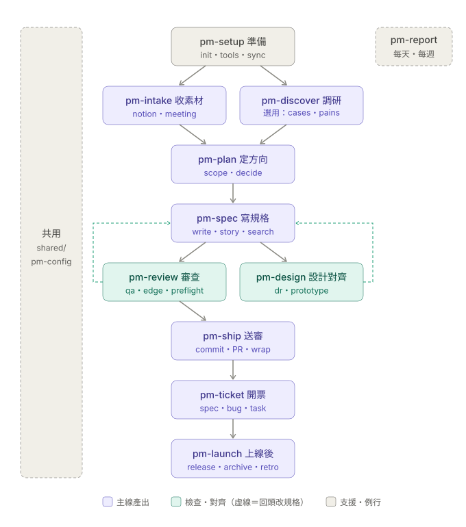

# PM Workflow Skills

我身為軟體 PM，每天實際在用的一整套 Claude Code skill：從收素材、定方向、寫規格、審查、送審、開票、上線，到每天和每週的進度同步。

一個 plugin `pm-workflow`，**11 個 skill，一個工作階段一個入口**，底下用子指令區分。全部用繁體中文產出。

```
/pm-spec write          寫規格
/pm-review all          一次跑完 QA、讀者、邊界、跨部門、矛盾檢查
/pm-review preflight    送審前用 QA 的標準完整預審
/pm-ship                分組 commit、開 PR
/pm-ticket spec         依規格拆前端 / 後端票
```

## 適合誰用

如果你符合下面任何一項，這套 skill 應該幫得上忙：

- **想捨棄 Notion，讓規格真正即時同步。** 規格寫在 Git 管理的規格庫，用草稿、PR、審查迭代；RD、QA、設計看的永遠是同一份最新版本，不會有「Notion 改了、票沒改」的落差。Notion 只在需要對外展示時單向輸出。
- **團隊用 Jira 開票。** 依規格拆前端 / 後端 Story、Bug、Sprint Bug、Task、優化票都有固定格式；開票前先列清單，確認後才建。
- **需要繁體中文、貼近台灣軟體團隊的工作方式。** 全部用繁體中文產出，用語與流程照台灣常見的分工：PM 寫規格、RD 實作、QA 驗收、設計師出稿；Sprint 開發、`ALPHA` / `BETA` / `PRODUCTION` 三個環境；release note 寫給業務、營運、客服看。

比較不適合的情況：規格主要寫在 Notion 或 Confluence 且不打算改、不用 Jira、或需要英文產出。

## 和 phuryn/pm-skills 的差別

[phuryn/pm-skills](https://github.com/phuryn/pm-skills) 是很完整的 PM skill 集，這個 repo 的結構也參考了它。兩者定位不同，可以一起用：

| | phuryn/pm-skills | pm-workflow-skills（本 repo） |
|---|---|---|
| 定位 | PM 方法論工具箱：探索、策略、市場研究、GTM、成長、數據分析 | 一位 PM 每天實際在跑的執行流程：從規格到上線 |
| 規模 | 9 個 plugin、72 個 skill、42 個 command | 1 個 plugin、11 個 skill，子指令按階段收斂 |
| 規格放哪 | 不限定，產出文件為主 | Git 管理的規格庫，草稿、PR、審查迭代 |
| 開票 | 不綁定工具 | Jira：依規格拆 FE / BE、Bug、Sprint Bug、Task 等固定格式 |
| 語言 | 英文 | 繁體中文 |
| 來源 | 以 PM 框架與最佳實務整理 | 從實際工作邊用邊改，附真實使用次數 |

簡單說：要做市場研究、定策略、規劃 GTM，用 phuryn/pm-skills；要把需求寫成規格、審查、送審、開票、上線，用這個 repo。

## 完整工作流程

<p align="center"></p>

主線由上往下；`pm-review` 找到問題、`pm-design` 有接受的設計修改時，都回到 `pm-spec` 修改（綠色虛線）。所有 skill 執行前都會讀左側的 `shared/` 與 `pm-config`；`pm-report` 是例行回報，不屬於單一需求。

各 skill 的子指令：

```
需求進來
│
├─ pm-setup ........ 0 準備
│   ├─ init ............ 專案背景 .pm/PROJECT.md
│   ├─ tools ........... 工具安裝與授權（第一次）
│   └─ sync ............ 規格庫更新到最新
│
├─ pm-intake ....... 1 收素材
│   ├─ notion .......... Notion 規格搬進 drafts，圖片搬到 Drive
│   ├─ meeting ......... 會議記錄轉成決策、待辦、增補提案
│   └─ material ........ 零散素材整理進規劃
│
├─ pm-discover ..... 1 調研（選用）
│   ├─ cases ........... 別人怎麼做、誰做不好
│   └─ pains ........... 這個痛是真的嗎：可追溯的實例證據
│
├─ pm-plan ......... 1 定方向
│   ├─ scope ........... 要不要做、範圍到哪、建 drafts 資料夾
│   └─ decide .......... 重大改動要拍板時，寫決策文件
│
├─ pm-spec ......... 2 寫規格
│   ├─ write ........... spec.md，AC 與指標一起寫
│   ├─ story / flow .... 從草稿產出 User Story、Userflow
│   ├─ reverse ......... 從程式碼反推現況規格
│   └─ search .......... 查某個邏輯目前寫在哪
│
├─ pm-review ....... 3～5 補強・審查・自查
│   ├─ qa .............. QA 角度挑缺漏、模糊、衝突
│   ├─ readers ......... 規則檢查＋讀者角色審查
│   ├─ edge ............ 邊界、例外、逆向流程
│   ├─ impact .......... 各部門影響、誰配合、誰拍板
│   ├─ consistency ..... 全文掃矛盾
│   ├─ polish .......... 統一用語、精簡
│   └─ preflight ....... 送審前在獨立 context 完整預審
│
├─ pm-design ....... 4 設計對齊
│   ├─ dr .............. 設計師的修改記成 DR，PM 拍板才改規格
│   └─ prototype ....... 可操作的 prototype
│
├─ pm-ship ......... 6 送審
│   ├─（不帶）.......... 分組 commit、push、開 PR
│   ├─ suggest / apply . PR 留建議、收到建議後套用
│   ├─ wrap ............ 收尾：changelog、群組同步文字
│   └─ notion .......... 定案的規格輸出成 Notion 展示頁
│
├─ pm-ticket ....... 7 開票
│   ├─ spec ............ 依規格拆前端 / 後端 User Story
│   └─ bug、sprint-bug、task、optimization、story、tech、form
│
└─ pm-launch ....... 8 上線後
    ├─ release ......... 給業務、營運、客服看的 release note
    ├─ archive ......... feature 從 drafts 封存
    ├─ sync-code ....... 程式碼的新行為補進現況規格
    └─ retro ........... 專案回顧 Keep / Problem / Try

每天・每週
└─ pm-report
    ├─ digest .......... 工作日早上整理昨天的改動與群組結論（適合排程）
    ├─ daily ........... Daily 回報
    └─ weekly .......... 週報（結果版＋個人紀錄版）
```

## 實際使用情況

2026 年 7 月中到 11 月中，我在 Claude Code 裡叫用的次數（重組前的名稱，不含排程自動執行）：

| 現在的位置 | 重組前 | 次數 |
|---|---|---|
| `pm-ticket` | 開 Jira 票 | 21 |
| `pm-ship` | `ship` | 14 |
| `pm-spec write` | `spec-write` | 11 |
| `pm-plan scope` | `spec-plan` | 9 |
| `pm-review`、`pm-plan decide`、`pm-launch release` | `pm` 的子指令 | 9 |
| `pm-setup tools` | `setup` | 7 |
| `pm-report weekly` | `weekly-recap-mode` | 6 |
| `pm-setup sync` | `sync` | 5 |
| `pm-review qa`、`pm-spec search`、`pm-ticket spec`、`pm-launch archive` | `spec-review`、`spec-search`、`ticket`、`archive` | 各 3 |

主力在「寫規格 → 送審 → 開票」這條線。

## 為什麼這樣設計

- **一個階段一個入口。** 原本有 24 個 skill、13 個 command，很多在做相近的事。依工作階段收成 11 個，記得「現在在哪個階段」就知道要叫哪個。
- **子指令按需載入。** 每個子指令的做法放在 `reference/<子指令>.md`，用到才讀，不會一次塞滿 context。
- **規格只有一個來源。** 規格只寫在 Git 管理的規格庫，Notion 只做單向輸出。
- **公司資訊和 skill 分開。** 路徑、Jira / Notion ID、專有名詞都放在私人的 `~/.claude/pm-config.md`。skill 本體只有一份，公開和自己用的是同一份。
- **先給草稿，再動外部系統。** 寫入檔案、Notion、Jira、Git 前一律先列提案，確認後才執行。
- **不推論。** 業務規則、名詞、角色不確定時，標 `🟡 待確認` 並附假說，不自己補。
- **獨立 context 審查。** `pm-review preflight` 用 subagent 執行，看不到前面的對話，避免作者的說明影響審查。

## 迭代紀錄

- **v1：只有 `pm`。** 一個 skill、9 個子指令，負責決策、審查、開票、公告。
- **規格從 Notion 搬到規格庫。** `pm` 原本的 `shape`、`spec`、`ac` 封存，改由團隊規格庫的 skill 負責；`critique` 和 `audit` 合併成 `review`。
- **v2：和團隊規格庫的 skill 放在一起。** 24 個 skill、13 個 command，完整但入口太多，相近的工具散在兩邊。
- **v3：依階段重組成 11 個。** 兩套開票合成 `pm-ticket`；所有審查、補強、自查合成 `pm-review`；commit、PR、收尾合成 `pm-ship`；寫作規則、共用原則合成 `shared/`；跨資料夾的橋接改成 `pm-config` 裡的一行規格庫路徑。

## 安裝

### Claude Code（CLI）

```bash
claude plugin marketplace add TsuWebber/pm-workflow-skills
```

```bash
claude plugin install pm-workflow@pm-workflow-skills
```

### 設定

把 [`pm-config.example.md`](pm-config.example.md) 複製到 `~/.claude/pm-config.md`，填入自己的規格庫路徑、Git 平台、Jira、Notion 設定與公司專有名詞。

### 規格庫結構

寫規格相關的 skill 讀寫規格庫裡的固定位置：

```
spec-repo/
├─ drafts/
│   ├─ _meta/TEMPLATE-*.md ...... 規格模板
│   └─ <sprint>/<feature>/ ...... 草稿：spec.md、decisions.md、actions.md
├─ specs/docs/<模組>/ ........... 已上線的規格
└─ archive/<sprint>/<feature>/ .. 已封存的 feature
```

模板與既有規格屬於各團隊自己的內容，不在這個 repo 裡。PR 流程預設是 Gitea，用其他平台要調整 `pm-ship`。

## 來源與去識別

- `pm-plan decide`、`pm-review readers / edge / impact / consistency / polish`、`pm-ticket` 的一般票型、`pm-launch release / retro`、`pm-report`、`pm-setup init`，以及 v3 的整體結構由我撰寫。
- 其他子指令改寫自我所在團隊共用的規格庫，原作者為團隊成員，經同意以去識別形式公開。
- 公司名稱、內部系統代號、品牌、人名、網址、ID、票號、本機路徑都已換成通用名稱或佔位符。

## 授權

MIT，見 [LICENSE](LICENSE)。
